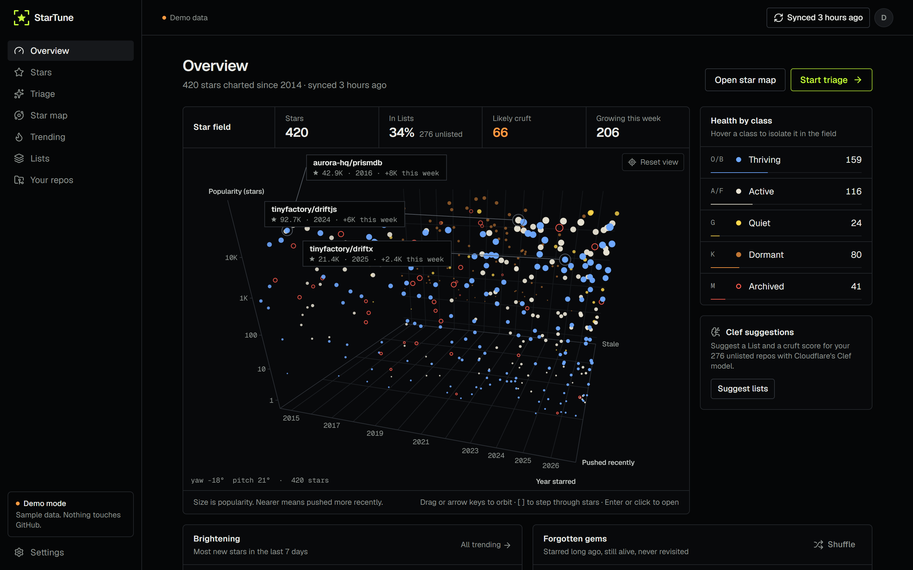

# 

**Bring your GitHub stars into focus.** Sort them into GitHub Lists, clear out the dead ones, see what's taking off, and find the gems you forgot about.

StarTune runs entirely on **your own Cloudflare account**: a single Worker with D1 for storage, Workers AI ([Clef](https://blog.cloudflare.com/clef-decision-models/)) for suggestions, and a daily cron for trending data.



*The Overview, shown with the built-in demo data.*

[](https://deploy.workers.cloudflare.com/?url=https://github.com/nerdstep/startune)

> Want to look around first? Run it locally and pick **Explore with demo data**, or open `/?demo=1`. The demo uses generated sample data and never touches GitHub.

## What it does

| | |
| --- | --- |
| **Overview** | Your stars as a 3D field you can turn by hand: when you starred each repo, how popular it is, and how recently it was pushed, colored by health class. Readouts for stars, Lists coverage, likely cruft, and growth this week; health by class; what's brightening; forgotten gems. |
| **Stars** | Fast, virtualized library with search, list, language, health, and year filters. Shift-click range selection; bulk add to lists, keep, or unstar. |
| **Triage** | A swipeable, keyboard-driven card deck (`←` unstar · `→` keep · `A` accept Clef's list · `S` snooze · `J` skip). Three queues: **Cruft**, **Unlisted**, and **Rediscover**. |
| **Star map** | The full-page field. Drag or use the arrow keys to orbit, `[` and `]` to step through stars, color by health or language, and hide a class or language from the legend. A flat 2D view with zoom and pan is one toggle away. Click or press Enter to open a repo. |
| **Trending** | Your stars ranked by 7- or 30-day growth (from daily snapshots), with a momentum plot whose pace trails show what's speeding up or slowing down. Plus fresh releases, and **Discover**: new repos in your most-starred topics. |
| **Lists** | Create, edit, and delete GitHub Lists. **List ideas** come from topics shared by unlisted repos. **Sort with Clef** classifies unlisted repos and lets you apply its confident picks in bulk. |
| **Your repos** | The public repos you own (forks behind a toggle): star history for each, 7- and 30-day growth, and weekly bars. What's waiting on you (PRs from others, issues without a reply) and what's worth a look (dormant repos still gaining stars, unreleased work, archive candidates, a missing description, license, or topics). Your latest and most-followed stargazers, and what they also star. |
| **Safety** | Every unstar can be undone (from the toast or Settings), and the repo's lists come back too. JSON export is available. |

### How health is classed

Every repo gets a health class from its last push, named after star classes: **O/B** thriving (pushed in the last 3 months), **A/F** active (the last year), **G** quiet (1 to 3 years), **K** dormant (3+ years), and **M** archived. The class shows as a color and a letter wherever the repo appears.

### How cruft is scored

Rules (archived; description says deprecated or moved; years since the last push; fork; small and inactive) give a probability, which is discounted when the repo still ships releases. When Clef has looked at a repo, its yes/no probability is blended in (55%). You can see the reasons on every card.

### How star history is charted

GitHub doesn't keep a repo's star count over time, so Your repos rebuilds it from the stargazer list. The newest 100 stars are exact. For older ones, StarTune reads every page when a repo has up to about 1,000 stars and samples 9 pages across the rest for bigger ones; sampled stretches are marked `≈`. GitHub only serves a repo's first 40,000 stargazers, so for bigger repos the stretch between those and the newest 100 is drawn as a straight line. Your repo list refreshes when you open the page and it's more than 6 hours old, and a chart less than a week old is extended with just the new stars.

### How Clef is used

Each Workers AI request asks Clef up to 64 typed questions. For each of ~32 repos it asks two:

- a `choice` question: which of your lists fits (or `none`);
- a `noul` (yes/no) question: is this repo likely cruft?

Output tokens aren't billed, so classifying a thousand stars costs very little and often fits in the Workers AI free tier. Set `CLEF_MODEL=clef` to use the larger model.

## Deploy

### One click

1. Create a **GitHub OAuth app** at [github.com/settings/developers](https://github.com/settings/developers).
   - Homepage URL: `https://startune.<your-subdomain>.workers.dev`
   - Callback URL: `https://startune.<your-subdomain>.workers.dev/auth/callback`
2. Click **Deploy to Cloudflare** above. It forks the repo, creates the D1 database, and asks for:
   - `GITHUB_CLIENT_ID` / `GITHUB_CLIENT_SECRET`: from step 1. If you'd rather sign in with a personal access token, enter `none` for both.
   - `SESSION_SECRET`: any long random string (`openssl rand -base64 32`).
3. Open the Worker URL and sign in. **The first person to sign in owns the install.** To let other people in, set `ALLOWED_USERS=alice,bob`.

### Manually

```bash
npm install
npx wrangler login
npx wrangler secret put GITHUB_CLIENT_ID
npx wrangler secret put GITHUB_CLIENT_SECRET
npx wrangler secret put SESSION_SECRET
npm run deploy   # build → deploy (auto-provisions D1) → apply migrations
```

### Signing in with a token

If you sign in with a classic personal access token, it needs the `read:user` and `public_repo` scopes. `public_repo` is what GitHub requires for starring and unstarring.

> **About the Lists scope:** GitHub doesn't document which OAuth scope its `UserList` mutations need. If creating a list or adding a repo to one fails, StarTune shows GitHub's "missing permission" message, which names the scope it wants. Add that scope to `GITHUB_SCOPES` (for an OAuth app) or to your token, then sign in again.

## Configuration

| Name | Kind | Default | |
| --- | --- | --- | --- |
| `GITHUB_CLIENT_ID`, `GITHUB_CLIENT_SECRET` | secret | — | OAuth app credentials, or `none` |
| `SESSION_SECRET` | secret | — | Encrypts GitHub tokens at rest (AES-GCM, HKDF). Changing it signs everyone out. |
| `ALLOWED_USERS` | var | *(empty)* | Comma-separated logins. Empty means the first sign-in claims the install. |
| `CLEF_MODEL` | var | `clef-flash` | `clef-flash` or `clef` |
| `GITHUB_SCOPES` | var | `read:user public_repo` | OAuth scopes requested at sign-in |

The cron (`17 9 * * *` UTC) refreshes repo metadata and records a star-count snapshot for up to 3,000 repos per run, your stars and your own repos together, oldest-fetched first. That keeps it under the Workers free-plan subrequest limit. Trending starts working once there are a few days of snapshots; until then, it falls back to stars per day since each repo was created.

## Local development

```bash
cp .dev.vars.example .dev.vars          # set SESSION_SECRET; "none" for OAuth is fine locally
npm run db:migrate:local
npm run dev                              # Workers AI is remote, so this needs `wrangler login`
CF_LOCAL_ONLY=1 npm run dev              # fully offline (Clef calls will fail)
npm run seed:local                       # fake signed-in user; cookie st_session=local-test-session-cookie
npx playwright install chromium          # once, for the browser tests
npm test                                 # vitest: unit tests, plus component tests in headless Chromium
npm run test:unit                        # unit tests only: scoring, own-repo rules, Clef request building, crypto
npm run lint                             # typecheck, oxfmt check, oxlint (+ type-aware rules), markdownlint
npm run lint:md                          # markdownlint only
npm run lint:fix                         # oxlint fixes, oxfmt, markdownlint fixes
```

Formatting is [oxfmt](https://oxc.rs/docs/guide/usage/formatter) and linting is [Oxlint](https://oxc.rs/docs/guide/usage/linter) with the `@shadcn/lint` design-token rules; VS Code applies both on save with the recommended Oxc extension. Markdown is checked by [markdownlint](https://github.com/DavidAnson/markdownlint-cli2), with rules in `.markdownlint.jsonc` that the recommended markdownlint extension also reads.

## Architecture

```bash
worker/        Hono API on Workers
  auth.ts      GitHub OAuth + PAT sign-in, sessions (hashed ids), encrypted tokens
  github.ts    GraphQL + REST: stars, lists (UserList), mutations, topic search, your repos, star history
  api.ts       /api/*: library, client-driven sync, lists, unstar/restar, review, Clef, discover, export, your repos (/mine)
  ai.ts        Clef request builder/parser (64-question batches)
  cron.ts      daily metadata refresh + snapshots + cleanup
  db.ts        D1 queries
shared/        zod schemas + pure scoring (health, cruft, growth, rediscover, list ideas, your-repo signals)
src/           React 19 + TanStack Router/Query/Virtual + shadcn/ui on Base UI + Tailwind v4
migrations/    D1 schema
brand/         logo files and the script that generates them
docs/          README screenshot
```

The browser calls the Worker through Hono's typed RPC client, so each request and response type comes straight from its route in `worker/`, and request bodies are validated with the zod schemas in `shared/`.

Sync is driven by the client: the browser calls `/api/sync` page by page, 400 stars per request. That way even a library of 10k stars never runs into Worker CPU or subrequest limits, and you get a live progress bar. A star that GitHub no longer reports is removed at the end of a full sync.

Chart colors come from a palette validated for color-vision deficiency on the dark surface (see `src/lib/palette.ts`). Colors are never the only signal: every chart has a legend, labels, and hover tooltips, health colors always come with a class letter, and the star map also uses hollow and faded marks.

## License

MIT
